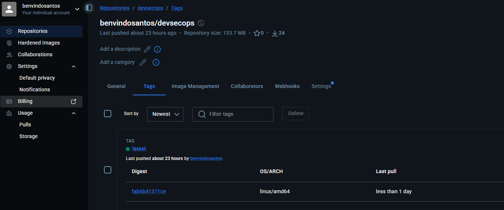
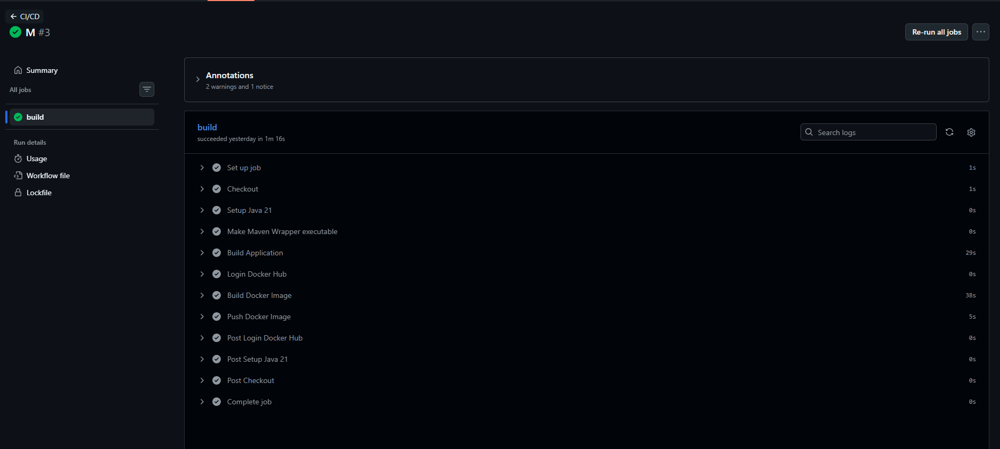
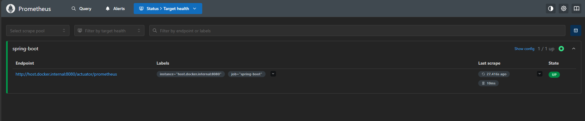
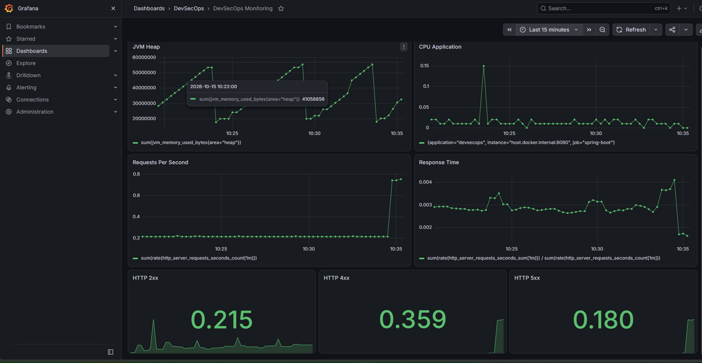
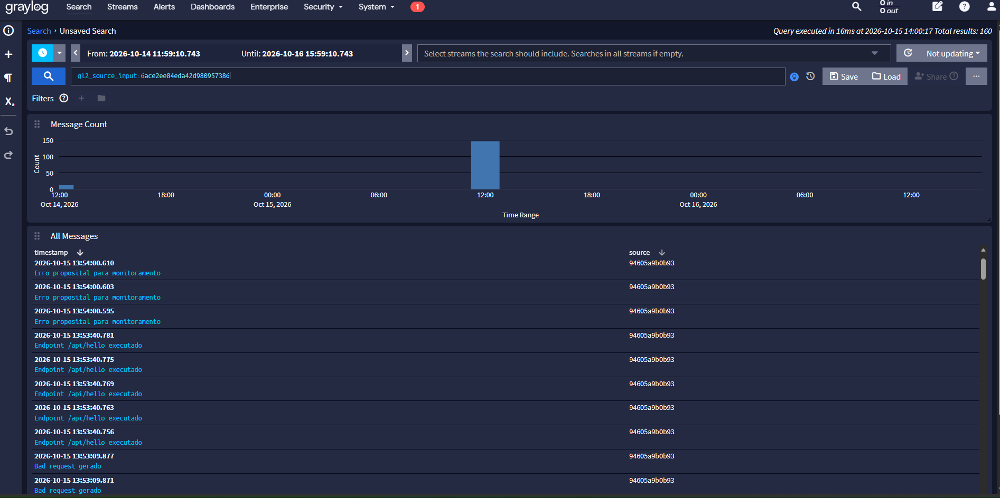

# 📚 BookStore DevSecops

Sistema de gerenciamento de livros desenvolvido com Java Spring Boot, utilizando práticas modernas de DevOps, Observabilidade e Monitoramento.

O projeto demonstra a implementação completa de:

-Conteinerização com Docker 
-Multistage Build  
-Integração Contínua (CI) 
-Entrega Contínua (CD) 
-Monitoramento com Prometheus 
-Observabilidade com Grafana 
-Centralização de Logs com Graylog 
-Publicação automatizada de imagens Docker 

# 📌 Objetivo
Desenvolver uma aplicação SpringBoot, implementando uma infraestrutura completa de monitoramento, observabilidade, centralização de logs e automação CI/CD.

🏗 Arquitetura da Solução
                     GitHub Actions
                            │
                            ▼
                       Docker Hub
                            │
                            ▼

                     BookStore API
                      Spring Boot
                            │
         ┌──────────────────┴──────────────────┐
         │                                     │
         ▼                                     ▼

    Prometheus                           Graylog
         │                                     │
         ▼                                     ▼

      Grafana                           OpenSearch
                                               │
                                               ▼
                                           MongoDB
# 📋 Pré-requisitos: 
    Antes de executar o projeto, certifique-se de possuir os seguintes softwares instalados:
    -Docker
    -docker --version
    -Docker Compose
    -docker compose version
    -Git
    -git --version

# 🔌Portas Utilizadas
      API Spring Boot	8080 
      Prometheus	9090 
      Grafana	3000 
      Graylog	9000 
      OpenSearch	9200 
      GELF UDP	12201 
  
# 🛠 Tecnologias Utilizadas:
    Java 21
    Spring Boot
    Maven
    Docker
    Docker Compose
    Prometheus
    Grafana
    Graylog
    MongoDB
    OpenSearch
    GitHub Actions
    Docker Hub
    
📦 Dockerfile Multistage Build
O projeto utiliza Dockerfile Multistage Build, conforme exigido pela atividade.

Build
FROM maven:3.9-eclipse-temurin-21 AS build
Responsável por:

    Download das dependências
    Compilação da aplicação
    Geração do JAR
    Runtime
    FROM eclipse-temurin:21-jre
  Responsável por:

    Execução da aplicação
    Redução do tamanho da imagem
    Ambiente de produção mais enxuto
# 🚀 Como Executar o Projeto
    Clonar o Repositório
    git clone https://github.com/domingosunoesc/Devsecops.git
    cd Devsecops
    Subir Toda a Infraestrutura
    docker compose up --build
    Esse comando irá iniciar:

    BookStore API
    Prometheus
    Grafana
    Graylog
    MongoDB
    OpenSearch
✅ Verificação da Instalação
Verifique os containers:

docker compose ps
Resultado esperado:

devsecops-app
devsecops-prometheus
devsecops-grafana
devsecops-graylog
devsecops-mongodb
devsecops-opensearch
Todos os serviços devem aparecer com status:

Up
🛑 Como Parar o Projeto
Parar todos os containers:

docker compose down
Parar e Remover Volumes
docker compose down -v
⚠️ Remove também os dados persistentes.

Reiniciar o Ambiente
docker compose up --build
Visualizar Logs
Todos os serviços:

docker compose logs -f
Somente a aplicação:

docker compose logs -f app
Somente o Graylog:

docker compose logs -f graylog
🌐 Endpoints da Aplicação
Listar Livros
GET /api/books
Exemplo de Resposta
[
  {
    "id": 1,
    "titulo": "Clean Code",
    "autor": "Robert C. Martin",
    "categoria": "Programação"
  }
]
Buscar Livro por ID
GET /api/books/{id}
Exemplo:

GET /api/books/1
Cadastrar Livro
POST /api/books
Exemplo
{
  "id": 4,
  "titulo": "Docker Deep Dive",
  "autor": "Nigel Poulton",
  "categoria": "DevOps"
}
Remover Livro
DELETE /api/books/{id}
Simular Erro
GET /api/books/error
Utilizado para demonstrar monitoramento e observabilidade.

🌐 Acesso aos Serviços
Aplicação
http://localhost:8080
Prometheus
http://localhost:9090
Grafana
http://localhost:3000
Credenciais
Usuário: admin
Senha: Admin@2026
Graylog
http://localhost:9000
Credenciais
Usuário: admin
Senha: Admin@2026!
📡 Monitoramento com Prometheus
A aplicação expõe métricas através do endpoint:

http://localhost:8080/actuator/prometheus
O Prometheus coleta continuamente:

Métricas JVM
Consumo de memória
Consumo de CPU
Requisições HTTP
Latência
Evidência
docs/prometheus.png

📊 Observabilidade com Grafana
O Grafana utiliza o Prometheus como fonte de dados.

O dashboard exibe:

Heap JVM
CPU da Aplicação
Requests Per Second
Tempo de Resposta
HTTP 2xx
HTTP 4xx
HTTP 5xx
Evidência
docs/grafana.png

📋 Centralização de Logs com Graylog
A aplicação envia logs estruturados para o Graylog utilizando GELF.

Infraestrutura:

Graylog
MongoDB
OpenSearch
Exemplos de logs:

INFO  Livro cadastrado
INFO  Consulta de livro
WARN  Livro não encontrado
ERROR Erro proposital da biblioteca
Evidência
docs/graylog.png

🔄 Pipeline CI/CD
A pipeline é executada automaticamente a cada push para a branch principal.

Etapas
Checkout
Setup Java 21
Maven Build
Testes
Docker Build
Login Docker Hub
Docker Push
Evidência
docs/github-actions.png

🐳 Docker Hub
A imagem é publicada automaticamente pela pipeline.

Repositório
benvindosantos/devsecops
Download
docker pull benvindosantos/devsecops:latest
Executar Apenas a API
docker run -p 8080:8080 benvindosantos/devsecops:latest
Evidência
docs/dockhub.png

✅ Requisitos Atendidos
Docker
Dockerfile Multistage Build
Docker Compose
CI/CD
GitHub Actions
Build Maven
Testes Automatizados
Build Docker
Push Docker Hub
Monitoramento
Spring Boot Actuator
Micrometer
Prometheus
Observabilidade
Grafana
Dashboard Customizado
Heap JVM
CPU
Requests por Segundo
Tempo de Resposta
HTTP 2xx
HTTP 4xx
HTTP 5xx
Logs
Graylog
OpenSearch
MongoDB
GELF UDP
INFO
WARN
ERROR
👨‍💻 Autor
Benvindo Domingos Ngola dos Santos

GitHub
https://github.com/domingosunoesc

Docker Hub
https://hub.docker.com/r/benvindosantos/devsecops

🎓 Conclusão
O projeto demonstra a implementação de uma plataforma completa de DevSecOps para uma aplicação de catálogo de livros, integrando:

✅ Docker Multistage Build
✅ GitHub Actions
✅ Docker Hub
✅ Prometheus
✅ Grafana
✅ Graylog
✅ OpenSearch
✅ MongoDB
✅ Docker Compose
✅ Monitoramento
✅ Observabilidade
✅ Centralização de Logs

🐳 Docker Hub

🔄 GitHub Actions

📡 Prometheus

Prometheus

📊 Grafana

Grafana

📋 Graylog

